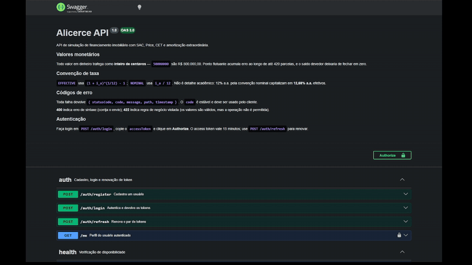

# Alicerce

[](https://github.com/NatanFurletti/alicerce-api/actions/workflows/ci.yml)


> API de simulação de financiamento imobiliário com SAC, Price, CET e amortização
> extraordinária.

**[Testar a API ao vivo (Swagger)](https://alicerce-api-agln.onrender.com/docs)** — hospedada no
plano gratuito do Render; a primeira requisição após inatividade pode levar até ~50 segundos.



*Login, tentativa de criar uma simulação sem token (**401**), autorização com o `accessToken` e a
mesma requisição aceita (**201**).*

**Status:** Etapas 0 a 6 concluídas — todos os endpoints implementados e testados (**358 testes
unitários + 100 e2e**, 98,9% de cobertura), documentados no Swagger e publicados. A Etapa 7
(extras opcionais) ainda não começou. Veja o [roadmap](#roadmap).

---

## O problema

Os simuladores de financiamento dos bancos são caixas-pretas. Eles informam o valor da parcela,
mas não mostram como ela é composta, não permitem comparar sistemas de amortização e não
simulam o efeito de aportes extras ao longo do contrato.

A Alicerce expõe o cálculo inteiro:

- Tabela de amortização completa, mês a mês
- Composição de cada parcela: juros, amortização, seguros MIP e DFI, taxa administrativa
- Comparação direta entre **SAC** e **Tabela Price** para os mesmos parâmetros
- **CET** (Custo Efetivo Total) calculado como TIR do fluxo de caixa, por método numérico
- Simulação de **amortização extraordinária**, com redução de prazo ou de parcela, mostrando
  juros economizados

---

## Stack

| Camada | Tecnologia |
|---|---|
| Runtime | Node.js LTS |
| Linguagem | TypeScript (`strict`) |
| Framework | NestJS |
| Banco de dados | PostgreSQL |
| ORM | Prisma |
| Testes | Jest |
| Documentação | Swagger / OpenAPI |
| Containerização | Docker + Docker Compose |
| CI | GitHub Actions |

---

## Arquitetura

Clean Architecture pragmática. A regra central: **o domínio não conhece framework nem banco de
dados.**

```
src/
  domain/          entidades, value objects, erros de domínio, interfaces de repositório
  application/     casos de uso e DTOs
  infra/
    database/      Prisma, repositórios, mappers
    http/          controllers, guards, exception filters
    auth/          JWT e hashing
  shared/          utilitários e tipos comuns
```

O núcleo de cálculo financeiro é **TypeScript puro**, sem nenhuma dependência de NestJS ou
Prisma, e é testado isoladamente. Essa separação é o que permite escrever os testes primeiro e
rodar toda a matemática do domínio sem subir infraestrutura.

As fronteiras entre camadas não são só convenção: importar `@nestjs/*` ou `@prisma/client` dentro
de `src/domain/` é **erro de ESLint** e quebra o CI. Uma regra de arquitetura que existe apenas na
documentação é uma regra que será violada.

Há ainda uma segunda tranca: [`architecture.spec.ts`](src/domain/architecture.spec.ts) varre os
imports das camadas e falha no `npm test` se alguém desarmar o lint com um `eslint-disable`.

### Casos de uso

Toda a orquestração vive em [`src/application/`](src/application/) e é testada **sem banco**,
contra repositórios em memória:

| Caso de uso | O que faz |
|---|---|
| `RegisterUser` | Cadastra usuário; a senha em claro nunca chega ao domínio |
| `CreateSimulation` | Valida elegibilidade, persiste e devolve o resumo |
| `GetSimulation` | Resumo com totais e CET, escopado ao dono |
| `GetSchedule` | Tabela de amortização paginada |
| `ListSimulations` | Listagem paginada do próprio usuário |
| `DeleteSimulation` | Remove, verificando propriedade antes |
| `AddExtraPayment` | Registra aporte e devolve o impacto no contrato |
| `CompareSystems` | SAC × Price lado a lado, sem persistir |

Casos de uso dependem de **interfaces** de repositório, nunca de implementações. `Clock` e
`IdGenerator` também são portas injetadas — é o que torna todo teste determinístico, sem depender
do relógio da máquina ([ADR-016](docs/decisions.md)).

### Um usuário nunca vê a simulação de outro

A regra é estrutural, não disciplinar. O repositório expõe:

```typescript
findByIdAndUserId(id: string, userId: string): Promise<Simulation | null>
```

Não existe `findById`. **O dono é argumento obrigatório**, então é impossível escrever a consulta
esquecendo o escopo — o compilador cobra. Um helper único concentra a verificação, e
[`simulation-scope.spec.ts`](src/application/use-cases/simulation-scope.spec.ts) exercita todos os
casos de uso que tocam uma simulação existente.

Recurso inexistente e recurso alheio devolvem **o mesmo erro**, de propósito: status diferentes
permitiriam enumerar quais ids existem ([ADR-015](docs/decisions.md)).

---

## Persistência

PostgreSQL 16 com Prisma. O schema guarda **apenas os parâmetros** da simulação — a tabela de
amortização é derivada e recalculada sob demanda ([ADR-003](docs/decisions.md)).

| Tabela | Observação |
|---|---|
| `users` | `email` com índice `UNIQUE` |
| `simulations` | Índice composto `(user_id, created_at DESC)`, cascade a partir de `users` |
| `extra_payments` | Índice `(simulation_id, month_number)`, cascade a partir de `simulations` |

Dinheiro é `BIGINT` de centavos, coerente com a [ADR-002](docs/decisions.md) de ponta a ponta.
Taxas são `double precision` — são fatores adimensionais, não dinheiro.

### O fake não pode mentir: teste de contrato compartilhado

Os casos de uso são testados contra repositórios em memória, o que os mantém rápidos e sem Docker.
O risco é evidente: se o fake ordena por data e o Prisma esquecer o `orderBy`, todos os testes
passam e a produção quebra.

A solução é uma [suíte de contrato](test/contracts/simulation-repository.contract.ts) escrita
contra a **interface** e executada contra as duas implementações — o fake nos testes unitários, o
Prisma nos de integração. Os fixtures inserem fora de ordem de propósito, porque um teste de
ordenação com fixture já ordenado passa por coincidência.

Verifiquei que funciona removendo o `orderBy` do repositório Prisma: **dois casos do contrato
falharam** contra o Postgres real ([ADR-018](docs/decisions.md)).

### Unicidade de e-mail sob concorrência

A checagem `findByEmail` antes de cadastrar tem uma janela TOCTOU, alargada pelo hash de senha ser
deliberadamente lento. Testado com duas requisições concorrentes: sem proteção adicional, **dois
usuários com o mesmo e-mail eram gravados**, ambos reportando sucesso.

A garantia real é a constraint `UNIQUE`, e o repositório traduz o erro `P2002` do Prisma para o
mesmo `EmailAlreadyInUseError` — então as duas rotas produzem o mesmo erro de domínio e a mensagem
nunca vaza o nome interno da constraint ([ADR-019](docs/decisions.md)).

---

## Autenticação

bcrypt (custo 12) para senhas, JWT com access de 15 minutos e refresh de 7 dias, **segredos
distintos** para cada um. Se o segredo de access vazar — e ele circula em muito mais requisições —,
o atacante ainda não forja refresh tokens.

**O guard é global**, e rotas públicas são marcadas com `@Public()`. A escolha é sobre o modo de
falha: protegendo rota a rota, esquecer o decorator deixa um endpoint **aberto em silêncio**; com
guard global, esquecer o `@Public()` **quebra o endpoint** na primeira chamada. Entre duas formas
de errar, a que grita ([ADR-021](docs/decisions.md)).

### Três armadilhas tratadas explicitamente

**1. O bcrypt trunca em 72 bytes — em silêncio.** Verificado:

```
senha cadastrada: 72×'a' + "SENHA_SECRETA_DO_USUARIO"
autentica com apenas 72×'a'?                    -> true
autentica com 72×'a' + "LIXO_QUALQUER"?         -> true
```

Qualquer sufixo serve. Por isso senhas acima do limite são **rejeitadas**, não truncadas — e a
contagem é em bytes, já que `á` ocupa 2 e emoji chegam a 4.

**2. Um refresh token não pode virar credencial de acesso.** O payload carrega um campo `type`,
verificado além da assinatura. Sem ele, um token de 7 dias abriria rotas protegidas — e o teste
cobre inclusive o cenário em que os dois segredos são iguais por erro de configuração.

**3. Mensagens iguais não bastam: o tempo também precisa ser.** O login verifica a senha **mesmo
quando o e-mail não existe**, contra um hash descartável. Sem isso, "e-mail inexistente"
responderia em microssegundos e "senha errada" levaria ~300ms — diferença mensurável que revela
quais e-mails têm conta ([ADR-022](docs/decisions.md)).

### Limitação conhecida: não há logout

Os refresh tokens são **stateless**, então **não existe revogação**. Um token roubado vale até
expirar (7 dias), não há como encerrar sessões remotamente, e por isso **nenhuma rota de logout foi
implementada** — prometer e não entregar seria pior que a limitação.

O que limita o dano é a vida curta do access token e a checagem, a cada refresh, de que o usuário
ainda existe. O caminho para revogação está registrado na [ADR-006](docs/decisions.md).

### Isolamento entre usuários, provado de ponta a ponta

[`user-isolation.e2e-spec.ts`](test/integration/user-isolation.e2e-spec.ts) exercita a cadeia real
— cadastro com bcrypt, login emitindo JWT assinado, `userId` extraído do `sub` do token, Postgres —
e confirma que o usuário B não alcança o dado de A por **nenhuma** das rotas: resumo, tabela,
exclusão ou listagem.

As decisões técnicas e as alternativas descartadas estão registradas em
[`docs/decisions.md`](docs/decisions.md).

---

## O núcleo financeiro

TypeScript puro em [`src/domain/finance/`](src/domain/finance/) — funções sem estado, sem NestJS,
sem Prisma, sem HTTP. Escrito com os testes primeiro: **135 testes, 99,5% de cobertura**.

| Peça | Arquivo | O que resolve |
|---|---|---|
| Conversão de taxa | [`rate.ts`](src/domain/finance/rate.ts) | Efetiva `(1+i)^(1/12)-1` e nominal `i/12` |
| SAC | [`sac.ts`](src/domain/finance/sac.ts) | Amortização constante, parcela decrescente |
| Price | [`price.ts`](src/domain/finance/price.ts) | Parcela fixa, amortização crescente |
| Encargos | [`schedule-common.ts`](src/domain/finance/schedule-common.ts) | MIP, DFI e taxa de administração |
| CET | [`cet.ts`](src/domain/finance/cet.ts) | TIR do fluxo por Newton-Raphson + bissecção |
| Aporte extraordinário | [`extra-payment.ts`](src/domain/finance/extra-payment.ts) | Reduzir prazo ou reduzir parcela |

### Duas convenções de taxa, porque o mercado usa as duas

A taxa é contratada ao ano, mas o cálculo é mensal — e há duas formas de converter:

- **Efetiva equivalente** `(1 + i_a)^(1/12) − 1`, coerente com juros compostos: doze meses dessa
  taxa capitalizam de volta exatamente na taxa anual contratada.
- **Nominal linear** `i_a / 12`, que ignora a capitalização e resulta numa taxa mensal maior.

Não é detalhe acadêmico: **12% a.a. pela convenção nominal capitalizam em 12,68% a.a. efetivos.**
Por isso a convenção é parâmetro de entrada, com a efetiva como default ([ADR-004](docs/decisions.md)).

### CET: o número que realmente permite comparar bancos

O CET é a **TIR** do fluxo de caixa — a taxa que iguala o valor presente de tudo que o cliente paga
ao que ele efetivamente recebeu. Como inclui MIP, DFI, taxa administrativa e despesas iniciais, é
sempre maior que a taxa de juros anunciada.

Não há solução fechada: o cálculo é numérico. A implementação usa **Newton-Raphson com fallback
para bissecção** — Newton converge em 4 ou 5 iterações, e quando a derivada degenera ou o passo
escapa do intervalo, a bissecção assume, mais lenta e infalível. Se nenhum dos dois convergir em
100 iterações, o resultado é um **erro explícito**, nunca um `NaN` disfarçado de taxa.

Dois defeitos reais encontrados pelos testes deste método estão registrados nas
[ADR-011](docs/decisions.md) e [ADR-012](docs/decisions.md) — incluindo um caso em que o método
devolvia uma taxa plausível cujo VPL não era zero.

### Aporte extraordinário: reduzir prazo ou reduzir parcela?

A pergunta que todo mutuário faz no balcão, respondida com números:

- `REDUCE_TERM` — abate o saldo e mantém a parcela; o contrato acaba antes.
- `REDUCE_INSTALLMENT` — abate o saldo e recalcula a parcela para o prazo restante.

O resumo devolve juros economizados, encargos economizados e meses eliminados. **Reduzir o prazo
economiza mais juros** — o teste que prova isso está em
[`extra-payment.spec.ts`](src/domain/finance/extra-payment.spec.ts).

### Verificação independente

Além dos testes unitários, o SAC e o Price foram conferidos contra uma implementação
independente em Python com `Decimal` de precisão arbitrária. Para R$ 400.000 em 360 meses a
0,8% a.m., os dois resultados batem **ao centavo**: R$ 577.600,57 de juros no SAC e
R$ 821.350,69 no Price, com saldo devedor final exatamente zero nos dois sistemas.

---

## Dinheiro nunca é `float`

Um financiamento de 420 meses acumula erro de arredondamento a cada parcela. Em ponto flutuante
binário `0.1 + 0.2 !== 0.3`, e esse desvio se propaga até o saldo devedor não fechar em zero.

Todo valor monetário no projeto é **inteiro de centavos**, do cálculo ao banco. Duas políticas
explícitas, implementadas e testadas em [`src/shared/money.ts`](src/shared/money.ts):

- **Arredondamento half-up simétrico** em torno do zero, aplicado parcela a parcela. `Math.round`
  sozinho não serve: em JavaScript ele arredonda em direção a +infinito, tratando `-0.5` como `-0`.
- **Resíduo explícito.** Dividir R$ 100,00 em 3 parcelas deixa 1 centavo sobrando. `divideCents`
  devolve esse resto em vez de escondê-lo, e a política do projeto é absorvê-lo na última parcela,
  para que a soma feche exatamente no principal.

O raciocínio completo, com as alternativas descartadas, está na
[ADR-002](docs/decisions.md#adr-002--representação-monetária).

---

## Roadmap

- [x] **Etapa 0** — Fundação: TypeScript strict, ESLint, Prettier, Jest, Docker Compose com Postgres, CI
- [x] **Etapa 1** — Núcleo financeiro em TDD: SAC, Price, encargos, CET, aporte extraordinário
- [x] **Etapa 2** — Domínio e casos de uso com repositórios em memória
- [x] **Etapa 3** — Persistência: Prisma, migrations, repositórios e testes de integração
- [x] **Etapa 4** — Autenticação JWT com access e refresh token
- [x] **Etapa 5** — Camada HTTP: controllers, validação, paginação, tratamento de erros
- [x] **Etapa 6** — Swagger, Dockerfile multi-stage, CI e deploy
- [ ] **Etapa 7** — Extras: exportação CSV, cache, histórico de simulações

Itens não marcados **não estão implementados**.

---

## Como rodar

Pré-requisitos: Docker e Node.js 20 LTS.

```bash
git clone https://github.com/NatanFurletti/alicerce-api.git
cd alicerce-api
cp .env.example .env
docker compose up -d     # sobe Postgres (dev :5432 e teste :5433)
npm install              # o postinstall já roda `prisma generate`
npm run prisma:deploy    # aplica as migrations
npm run start:dev
```

A aplicação sobe em `http://localhost:3000`, com [todos os endpoints](#endpoints) funcionais e a
documentação interativa em `http://localhost:3000/docs`.

```bash
curl http://localhost:3000/health
# {"status":"ok","uptimeSeconds":3,"timestamp":"..."}
```

### Testes

```bash
npm test              # unitários
npm run test:cov      # relatório de cobertura
npm run test:e2e      # end-to-end
npm run lint          # ESLint, inclui as regras de fronteira entre camadas
npm run typecheck     # tsc --noEmit
```

### Bancos de dados

O Compose sobe **dois** containers Postgres 16:

| Container | Porta | Banco | Persistência |
|---|---|---|---|
| `alicerce-postgres` | 5432 | `alicerce` | volume nomeado |
| `alicerce-postgres-test` | 5433 | `alicerce_test` | `tmpfs` — some ao parar |

A separação é física, não por convenção: um teste e2e não tem como escrever no banco de
desenvolvimento porque aponta para outra porta e outro container. O banco de teste vive em
memória, o que o torna rápido e descartável.

---

## Documentação interativa

Swagger em **`/docs`**, gerado a partir dos mesmos decorators que validam a entrada
([ADR-007](docs/decisions.md)) — uma única declaração vira validação e documentação, sem risco de
a documentação descrever um contrato que o código não cumpre.

A demonstração no [topo deste README](#alicerce) foi gravada no ambiente publicado. Para rodar
localmente:

```bash
npm run start:dev
# abra http://localhost:3000/docs
```

Faça login em `POST /auth/login`, copie o `accessToken`, clique em **Authorize** e todas as rotas
protegidas passam a funcionar direto pela interface. O token persiste entre recarregamentos.

---

## Endpoints

Todos implementados, documentados no Swagger e cobertos por testes e2e.

| Método | Rota | Descrição | Auth |
|---|---|---|---|
| POST | `/auth/register` | Cadastro de usuário | pública |
| POST | `/auth/login` | Autenticação, devolve os dois tokens | pública |
| POST | `/auth/refresh` | Renova o par de tokens | pública |
| GET | `/me` | Perfil do usuário autenticado | 🔒 |
| POST | `/simulations` | Cria, calcula e persiste | 🔒 |
| GET | `/simulations` | Listagem paginada do próprio usuário | 🔒 |
| GET | `/simulations/:id` | Resumo com totais e CET | 🔒 |
| GET | `/simulations/:id/summary` | Idem, rota explícita do SPEC | 🔒 |
| GET | `/simulations/:id/schedule` | Tabela de amortização paginada | 🔒 |
| POST | `/simulations/:id/extra-payments` | Aporte extraordinário e impacto | 🔒 |
| DELETE | `/simulations/:id` | Remove a simulação | 🔒 |
| POST | `/simulations/compare` | SAC e Price lado a lado | 🔒 |
| POST | `/simulations/preview` | Cálculo público, sem persistir | pública, 10/min |
| GET | `/health` | Liveness probe | pública |

### Exemplo real

```bash
# 1. cadastro e login
curl -X POST localhost:3000/auth/register -H 'Content-Type: application/json' \
  -d '{"name":"Natan","email":"demo@alicerce.dev","password":"senha-valida-123"}'

TOKEN=$(curl -s -X POST localhost:3000/auth/login -H 'Content-Type: application/json' \
  -d '{"email":"demo@alicerce.dev","password":"senha-valida-123"}' | jq -r .accessToken)

# 2. simulação: imóvel de R$ 500 mil, 20% de entrada, 360 meses a 9,75% a.a.
curl -X POST localhost:3000/simulations -H "Authorization: Bearer $TOKEN" \
  -H 'Content-Type: application/json' -d '{
    "propertyValueCents": 50000000, "downPaymentCents": 10000000,
    "termMonths": 360, "annualRate": 0.0975,
    "rateConvention": "EFFECTIVE", "amortizationSystem": "SAC",
    "charges": {"mipMonthlyRate":0.00025,"dfiMonthlyRate":0.00005,"adminFeeCents":2500}
  }'
```

Resultado desta chamada:

| | |
|---|---|
| Financiado | R$ 400.000,00 |
| Primeira parcela | R$ 4.374,32 |
| Juros totais | R$ 561.935,83 |
| Taxa contratada | 9,7500% a.a. |
| **CET** | **10,3058% a.a.** |

A diferença entre a taxa contratada e o CET são os encargos — MIP, DFI e taxa de administração.
É exatamente o número que os simuladores de banco não mostram.

### Formato de erro

Toda falha devolve o mesmo envelope, com um `code` estável que o cliente pode tratar:

```json
{
  "statusCode": 422,
  "code": "LTV_EXCEEDED",
  "message": "LTV de 98.00% excede o máximo de 80%. Aumente o valor da entrada.",
  "path": "/simulations",
  "timestamp": "2026-08-12T19:09:16.131Z"
}
```

**400 é sintaxe, 422 é regra de negócio.** `termMonths: "trezentos"` dá 400 — corrija o envio.
`termMonths: 500` dá 422 — o formato está certo, mas o prazo excede o máximo. A distinção diz ao
cliente o que fazer ([ADR-023](docs/decisions.md)).

Erros inesperados viram `500 INTERNAL_ERROR` com mensagem genérica: a original nunca vai para a
resposta, porque um erro do Prisma vazaria nome de tabela e trecho de SQL.

### Rate limiting

100 req/min por IP no geral, **5/min** em cadastro e login, **10/min** no preview público. O limite
apertado no login também mitiga o custo de CPU assumido na [ADR-022](docs/decisions.md) — o
endpoint gasta ~300ms de bcrypt mesmo quando o e-mail não existe.

---

## Docker e deploy

O [`Dockerfile`](Dockerfile) é multi-stage em três etapas — dependências, compilação e execução.
A imagem final não carrega TypeScript, Jest nem código-fonte: só o JavaScript compilado, as
dependências de produção e o Prisma Client.

Quatro decisões que valem apontar:

- **Roda como usuário `node`**, não root. Um comprometimento da aplicação não vira root no
  container.
- **`dumb-init` como PID 1.** Sem um init adequado, o Node não recebe `SIGTERM` corretamente e o
  container leva 10s para morrer em todo deploy, sem executar o shutdown gracioso do Nest.
- **`HEALTHCHECK` sem `curl`**, usando o próprio Node — a imagem final não precisa carregar um
  cliente HTTP só para isso.
- **`migrate deploy` no start.** O mesmo comando que o CI executa, então uma migration quebrada
  aparece no PR e não no servidor.

```bash
docker build -t alicerce-api .
docker run -p 3000:3000 --env-file .env alicerce-api
```

### Deploy

A infraestrutura está descrita em [`render.yaml`](render.yaml) — app e Postgres num arquivo
versionado, sujeito a revisão em PR como qualquer outro código. Os segredos de JWT são gerados
pelo próprio Render (`generateValue`) e nunca passam pelo repositório.

O passo a passo está em [`docs/deploy.md`](docs/deploy.md), incluindo as limitações do plano
gratuito — a mais visível é a **hibernação após 15 minutos sem tráfego**, que faz a primeira
requisição levar ~30 segundos.

**Em produção:** [alicerce-api-agln.onrender.com/docs](https://alicerce-api-agln.onrender.com/docs)
— o Swagger permite cadastrar um usuário, autenticar e criar simulações direto no navegador.
A raiz `/` redireciona para o `/docs`.

---

## Nota sobre parâmetros de mercado

Alíquotas de seguro, limites de comprometimento de renda, LTV máximo e prazo máximo são
**parâmetros configuráveis**, com valores default apenas de referência. Não constituem
recomendação financeira nem refletem necessariamente as regras vigentes de nenhuma instituição.
Confira as condições reais junto ao agente financeiro.

---

## Autor

**Natan Furletti** — desenvolvedor backend

[LinkedIn](https://www.linkedin.com/in/natan-furletti/) · [GitHub](https://github.com/NatanFurletti)

Atuei três anos com crédito imobiliário e financiamento habitacional antes de migrar para
desenvolvimento. Este projeto nasceu de um problema que eu via todo dia: cliente assinando um
contrato de trinta anos sem entender a composição da própria parcela.
